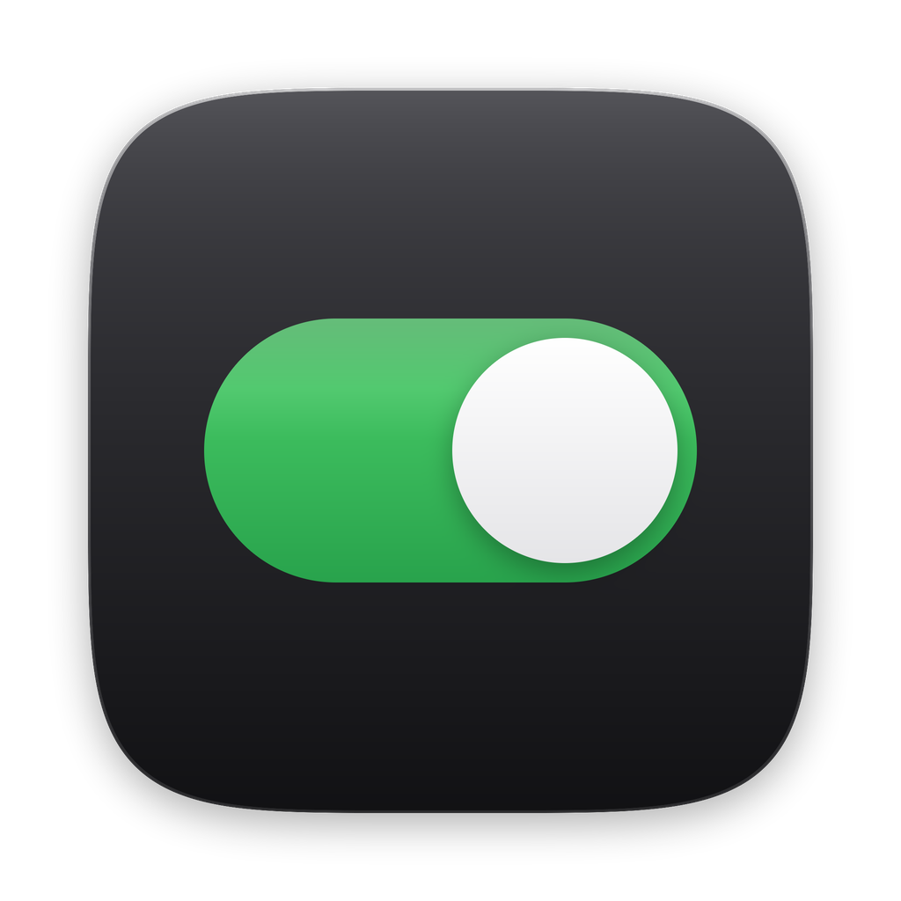

<p align="center"></p>

<h1 align="center">Pulsar</h1>

<p align="center">The notch of your Mac, working with Claude.<br>
The whole app, open: build it yourself for free, or make it yours with Claude Code.</p>

---

I built Pulsar with Claude. I designed every part, Claude wrote the Swift with me, and I used it every day until it felt right. This repo is all of it: every module, every tile, the Claude Code hook, the sounds.

- **Can build it?** Run one script and you have everything unlocked, for free.
- **Want it ready to use?** The signed app is on [Gumroad](https://juliendesigncraft.gumroad.com): Lite is free, the full app is a one-time purchase. Buying it is also how you support the project.
- **Want to build it from scratch, your way?** The [`prompts/`](prompts) folder has one prompt per part, with the reference images and the problems that cost me days.
- **Want your own version?** Open this folder in Claude Code. It reads `CLAUDE.md` and knows where everything lives, so you can ask for changes in plain words. Start with `/make-it-mine`.

## What it does

**In the notch**
- Claude Code live: what it is doing, every step, the files it changed and their diffs
- Permissions answered from any app (Allow, Deny, Always), or with ⌃⌥Y / ⌃⌥N
- Music from Spotify or Apple Music, with the cover and synced lyrics
- Your next meeting, five minutes before, with Join
- Tiles you arrange: weather, calendar, timer, clipboard, a shelf for files, to-do
- Stow: drop a file on the notch and get JPEG, PNG, PDF, MP4 and more

**On the edge of the screen**
- A volume dial, a mixer for each app, a timer, screen and keyboard light

**In the menu bar**
- Hide the icons you don't need, your desktop in a menu, the small system switches
- Keyboard sounds in every app: twelve mechanical keyboards and a typewriter

**Everywhere**
- Rowline: your windows side by side in a row that scrolls (⌃⌥⌘F)
- Voice: hold ⌃⌥ to dictate, ⌃⌘ to give a command, ⌃⇧ to circle something and ask
- Dark Matte and White Matte, for Pulsar and, if you want, macOS, the wallpaper and the folders you pick

## Build it

You need macOS 26 (Tahoe) on Apple silicon and the Xcode Command Line Tools.

```bash
xcode-select --install   # once, if you don't have them
./build.sh
open build/Pulsar.app
```

A build from source has every part unlocked: no license key, no trial, no update checks. Pulsar asks for each macOS permission only when a feature needs it.

Rebuilt apps are signed ad-hoc, so macOS asks for permissions again after each build. `build.sh` explains how to sign with your own certificate to keep them.

### Connect Claude Code

In Pulsar Settings (⌘,), Claude Code, Connect. Pulsar shows what it adds to `~/.claude/settings.json`, keeps a dated copy of your file and writes only after you confirm. The hook it installs is `agente/hook.py`.

## Make it yours

This is the part I care about most. Pulsar is built to be changed by talking to Claude:

1. Open this folder in [Claude Code](https://claude.com/claude-code).
2. Type `/make-it-mine`, or just say what you want: *"make the accent green"*, *"add a tile that shows my GitHub notifications"*, *"remove the voice module"*.
3. Run `./build.sh` and open the new app.

`CLAUDE.md` is the map Claude follows, and [CUSTOMIZE.md](CUSTOMIZE.md) has prompts that work well.

A note on language: the code comments are in Italian, the language I think in. Claude reads them without trouble, and the app itself is in English and Italian.

## Build your own from the prompts

[`prompts/`](prompts) is Pulsar as prompts: Lite, Agent, Mixer, Island, Stow, Rowline and Themes, one folder each. Paste a prompt into Claude Code with its images and build that part from zero. Start with Lite, then ask Claude to add the next part to the same app.

If Pulsar is useful to you, a star on this repo helps other people find it.

## How it is organized

| Folder | What is inside |
|---|---|
| `Core/` | The shared base: settings, theme colors, panels, license, permissions, the Claude Code connection |
| `Moduli/` | One folder per part: `Agent`, `Isola` (the island), `Widget` (tiles), `Mixer`, `Media`, `Convertitore` (Stow), `Rowline`, `Anima` (voice), `Griglia` (app grid), `Temi`, `Lite` (menu bar, settings, the app entry point) |
| `agente/` | The Claude Code hook (Python, standard library only) |
| `sounds/` | Keyboard and mouse sounds, with their sources in `sounds/FONTI.md` |
| `Vendor/` | libwebp (for WebP export) and Sparkle (updates, off in source builds) |

## License

[PolyForm Noncommercial 1.0.0](LICENSE). You can use Pulsar, build it, change it and share your changes, for anything that is not commercial. You can't sell it or a version of it. Third-party parts keep their own licenses, listed in [NOTICE.md](NOTICE.md).

Made by [@juliendesigncraft](https://www.instagram.com/juliendesigncraft), with Claude.
