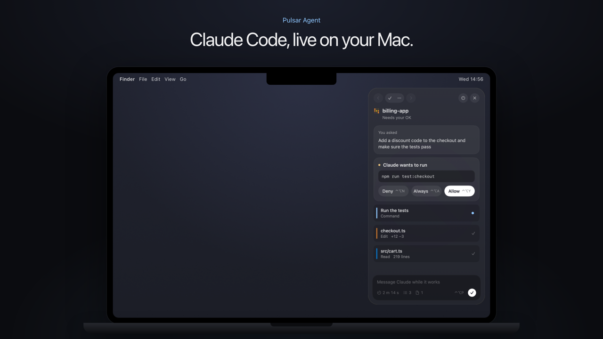

# Pulsar Agent

Claude Code, live on your Mac. While Claude works, a small shape around the notch says what it is doing right now. When it asks to run a command, you answer from the notch or with two keys, from any app. A column on the right edge opens a panel with every step, the files it changed and a summary in plain words.

You need Claude Code installed, with your own Claude plan.

## How to use it

1. Download the two images in [`images/`](images): the panel and the pill in the notch. You'll attach them as references.
2. Copy the prompt below and paste it into Claude Code, on a Mac, with the two images attached. Start in an empty folder, or in your Pulsar Lite folder if you built that first.
3. Build it step by step: Claude shows you a plan first and waits for your OK.

| The panel | The pill in the notch |
|---|---|
|  |  |

**Prompt, for Claude Code**

````text
Build me a native macOS app (Swift + AppKit/SwiftUI, macOS 14 or later, Apple Silicon) that shows Claude Code live on my Mac. It lives in the menu bar, with no Dock icon. If there is already a Pulsar Lite app in this folder, add this as a new part of it instead of a new app. No Xcode project: one build.sh that compiles with swiftc and makes the .app.

I attached two screenshots: the panel on the right edge, and the pill in the notch. Match their layout, spacing, rounded corners and colors as closely as you can, and use them to check each step.

Work in small steps. Before writing code, show me a short plan and the list of permissions the app will ask for, and wait for my OK. After every step, build it and tell me how to try it.

1. The bridge with Claude Code
- A small Python script, hook.py, that Claude Code runs on its hook events: UserPromptSubmit, PreToolUse, PostToolUse, PostToolUseFailure, PermissionRequest, Stop, SessionEnd.
- On every event it updates one state.json in the app's folder in ~/Library/Application Support: one entry per session, with the project, what I asked, the steps (read, edit, run, find, web, agent, plan) with their state, the files changed and the time.
- Then it pings the app on a Unix socket in the same folder, so the app redraws at once. A timer that rereads the file every second is only a safety net.
- The app copies hook.py from its bundle into that folder at every launch, so updates arrive by themselves.
- A script that replays a whole fake session in 30 seconds, with a permission request, so I can try everything without Claude.

2. The pill in the notch
- Compact by default, like the Dynamic Island: as tall as the notch, a small animated 3x3 pixel glyph on the left that changes color with the kind of work, the time elapsed on the right.
- It opens to two lines when the mouse is over it, when Claude asks for a permission, for 3 seconds when a new request starts or a step fails, and for 6 seconds at the end. Top line, small and grey: what Claude just did ("Read billing.ts  219 lines", "+3 -1"). Bottom line, white: what it is doing now.
- At the end: "Done" and the time, then it goes back.
- The pill is always black, because it continues the real notch. Its top corners curve outwards into the notch, like shoulders.
- With more sessions at once, follow the one waiting for my OK, otherwise the one started last. Never jump between them.
- A setting: Compact, Only when needed, Always open.

3. Permissions
- When Claude asks to run something, the pill opens with the whole command, never a cut version, and three buttons: Deny, Always (only when Claude Code offers a rule), Allow.
- Global keys, from any app: Control-Option-Y allows, Control-Option-N denies, Control-Option-A always allows.
- A soft system sound when Claude asks (Tink) and when it finishes (Glass), at low volume, so I can look away. A switch turns them off.

4. The column and the panel
- A column of round icons attached to the right edge of the screen: Work, Files, Approve (with a dot when Claude is waiting), Sessions. It hides off screen like the Dock and comes back when the mouse touches the edge at its height; half a second after the mouse leaves, it goes away. It comes out by itself when Claude asks for a permission.
- One click opens the panel to the left of the column, floating 12 pt from the edge. Control-Option-P opens and closes it.
- In the panel: "You asked" (my request, clean), the permission card when there is one, then the steps as rows with a thin colored bar on the left, the newest on top, the state on the right, and "try 2" when a failed command passes later.
- When the work is done: "In plain words" (Claude's last message without the markdown), then Time, Steps, Files changed with +N -M, Tests. A warning line if a file changed after the tests ran.
- Files: every changed file with +N -M and "See diff", which opens a window with the whole diff, added lines green and removed lines red.
- Sessions: every running session as a pill, named with the chat title or, if missing, the first words of the request.
- At the bottom, a rounded field "Message Claude while it works", with time, steps and files.

5. Connect it to Claude Code, with one button
- A settings page with Connect: show me exactly what will be added to ~/.claude/settings.json, keep a dated copy of my file next to it, and write only after I confirm. Disconnect removes the same entries and nothing else.
- If the file has a shape you don't expect, don't touch it and say so.

Style
- Apple style, Dark and White Matte following the system. Dark Matte: panel #16181F, cards #21242D, text #E3E7EF, secondary text #A4ABBA, accent #8FC7FF. White Matte: panel #F7F8FA, cards #FBFBFC, text #1E2129, secondary text #545A69, accent #3B82D0.
- The accent (light blue) for every "active" or "new" state. Amber only for "waiting for you", slightly muted. No borders, no outlines. One typeface only, SF, and SF Symbols for icons.

Things that will trip you up
- The hook must never stop Claude. Swallow every error and exit 0. If the socket doesn't answer, the app is closed: exit at once and let Claude Code ask in the terminal as usual.
- Permissions: the PermissionRequest hook waits for the answer on the socket ({"op":"wait","id":...}), at most 25 seconds, then gives up and the terminal asks. Give that hook a timeout of 40 in settings.json, the others 5. Answer with hookSpecificOutput: {"hookEventName":"PermissionRequest","decision":{"behavior":"allow"}}, or "deny" with a short message.
- Always: when the event carries permission_suggestions, send them back as decision.updatedPermissions. That is how "Yes, don't ask again" works in the terminal.
- If I answer before the hook starts waiting, keep the answer and deliver it as soon as the hook asks for it.
- Run the hook with /usr/bin/python3 and the full path in quotes ("$HOME/Library/Application Support/..."): the space in the path breaks the command otherwise. python3 comes with Apple's Command Line Tools; if they are missing, say so in the README.
- Connect must copy hook.py into place before it writes settings.json. If settings.json points to a hook that isn't there, Claude Code stops at every prompt. If the copy fails, write nothing.
- Several hooks run at the same time when Claude works in parallel. Lock state.json while you read and write it, or two events overwrite each other.
- The message field: the app writes the message to a file per session, and the hook delivers it after the next tool as additionalContext (PostToolUse), or, if Claude is finishing, with decision "block" on Stop so it goes on with the new instruction. Turn the field off when the chat is not working: there is no clean way to wake a stopped chat from outside.
- Scheduled tasks arrive as a raw "<scheduled-task ...>" prompt. Show "Scheduled: name" instead.
- The ^-key shortcuts need the Accessibility permission. Movements of the mouse at the edge need nothing.
- The panel must not steal focus from the app I'm using: a non-activating panel that becomes key only when I click the message field.
- Fix the window sizes (sizingOptions = []). With several sessions a segmented control widened the panel past the screen edge; use a pop-up menu.
- Find the notch with NSScreen.auxiliaryTopLeftArea and auxiliaryTopRightArea. On a Mac without a notch, draw a small black shape at the top centre and use that.
- The notch window needs a level above the menu bar and collectionBehavior [.canJoinAllSpaces, .fullScreenAuxiliary, .stationary], or it disappears in full screen and on other desktops.
- Sign every build with the same local code signing certificate, not ad hoc, and keep the same bundle id. With ad hoc signing macOS ties Accessibility to the file's fingerprint and every rebuild loses it.

Rules
- Nothing leaves the Mac. The hook and the app only talk over the local socket. No accounts, no analytics.
- Never edit ~/.claude/settings.json without showing me the change and asking first.
- Write tests for the pure parts: the state file updates, the +N -M counts, which session the pill follows.
- A README that says how to build, run, connect, disconnect and remove the app.
````

It won't come out identical to mine on the first try. You'll get a working first version in an afternoon: then try it with the fake session, compare it with the images and ask Claude for one detail at a time.

## Credits

The idea came from Dotpals by rikin.ai. The socket, the Always rule and the diffs follow ideas from coucou by Louis Raillé (MIT license). No code, sounds or mascots from either: Pulsar Agent is written from scratch.
