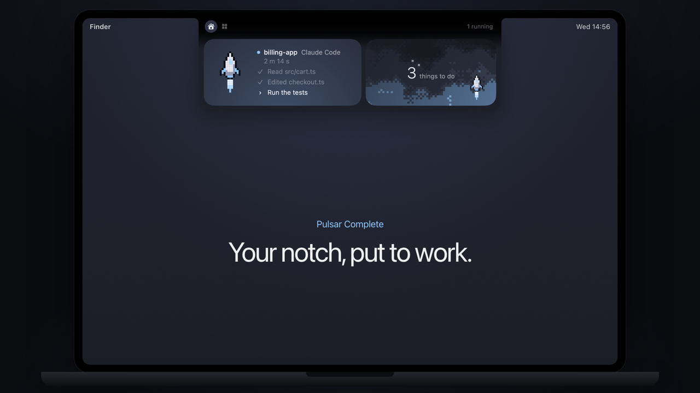

# Pulsar Island

The notch as a Dynamic Island. Music with live lyrics, weather, your next meeting with a Join button, tiles you arrange yourself, small peeks for battery, apps and notifications. If you built Pulsar Agent, Claude lives here too: its questions appear as choices, and a file you drop on the notch goes with your next message.

## How to use it

1. Download the three images in [`images/`](images): the island open on Home, and the tiles in Dark Matte and White Matte. You'll attach them as references.
2. Copy the prompt below and paste it into Claude Code, on a Mac, with the images attached. Start in an empty folder, or in your Pulsar folder if you built Lite or Agent first.
3. Build it step by step: Claude shows you a plan first and waits for your OK.

| Home, with Claude at work | Tiles, Dark Matte | Tiles, White Matte |
|---|---|---|
|  |  |  |

**Prompt, for Claude Code**

````text
Build me a native macOS app (Swift + AppKit/SwiftUI, macOS 14 or later, Apple Silicon) that turns the area around the MacBook notch into a Dynamic Island, like the iPhone one. It lives in the menu bar, has no Dock icon, and starts at login only if I turn it on. If there is already a Pulsar app in this folder, add this as a new part of it instead of a new app. No Xcode project: one build.sh that compiles with swiftc and makes the .app.

I attached three screenshots: the island open on Home, and the tiles in Dark Matte and White Matte. Match their layout, sizes, spacing, rounded corners and colors as closely as you can, and use them to check each step.

Work in small steps. Before writing code, show me a short plan and the list of permissions the app will ask for, and wait for my OK. After every step, build it and tell me how to try it.

1. The island
- A borderless, transparent window over the notch, above all apps (also in full screen), centred on the screen that has the notch.
- States: resting (just the black notch), compact (a black pill that grows to the sides of the notch), peek (a small bubble under the notch for 2 to 4 seconds), expanded (opens 0.25 s after the mouse rests on the notch, closes 0.05 s after it leaves; a click keeps it open), alert (opens by itself).
- When open, a neck as wide as the notch stays in the menu bar band and the panel opens under the menu bar: corners of 22 at the top, 28 at the bottom, curving into the notch. Beside the neck the menu bar stays free and clickable.
- At the top of the open island: Home and Tiles on the left, a short status on the right ("1 running", "waiting for you").
- Spring animations, a soft shadow, no borders.

2. Home
- With music playing: a big music tile, and a column of three rows (weather, next event, last thing Claude did).
- With nothing playing: one wide welcome card with a greeting, the time and today's to-dos.

3. Tiles (each one I can show, hide, resize from 1 to 4 cells by dragging a handle, reorder by dragging, remove with a minus and add back from chips in a Customize mode)
- Music: Spotify and Apple Music. The cover, title, artist, a progress bar with elapsed and total time, previous, play-pause, next, and the current line of the lyrics, synced, from LRCLIB (free, no key), with a local cache. While music plays the tile takes the colors of the cover (the most saturated, the average, the lightest) moving slowly behind the text, with a small 5x5 pixel equalizer next to "Now playing". In pause it stays still, in the accent color.
- Weather from Open-Meteo (free, no key): temperature, a still icon, high and low, for a city I type in the settings.
- Next event (EventKit, read only) and a 25-minute focus timer with start and reset.
- Optional: Clipboard (the last few items), a Tray where files dropped on the island wait, Recent files.
- Next meeting: from 5 minutes before it starts until 10 minutes after (never after it ends), the compact island shows a camera and the minutes left; open, the title, the time and a Join button. Find the link in the event's URL, then location, then notes: Zoom, Google Meet, Microsoft Teams. Without a link, "Open in Calendar". All-day events don't count; if two overlap, the one that starts first wins.

4. Peeks (small bubbles that appear and go away, never over the menu bar)
- An app opens or quits (with its icon), charger connected, battery at 20% and 10% and full, Do Not Disturb on or off, a notification banner.

5. Claude Code in the island (only if this app already has the Claude Code hook from Pulsar Agent; otherwise skip this step and tell me)
- Compact: an icon for the current step on the left, a small animated grid on the right that changes color when Claude waits or finishes.
- Permission and Done open an alert in the island, with the command, Deny, Always and Allow.
- Questions: when Claude uses AskUserQuestion, open the island with the question and its choices as pills (up to four questions, 1/2, 2/2; for multiple-answer questions, tick and send). "In the terminal" leaves the answer to the terminal.
- Files for Claude: a file brought near the notch, even with the island closed, opens a drop zone: "Drop here, it goes to Claude" if a session is alive, otherwise "it goes to the Tray". Holding Option always sends it to the Tray. After the drop: "On board, it leaves with your next message", and a paperclip with the count in the compact island until Claude takes it.

6. Settings
- A small menu: show or hide each tile, the city, Dark Matte or White Matte, launch at login, quit.

Style
- Two themes, flat and matte, no glass, switchable from the menu:
  - Dark Matte: background #16181F, tiles #21242D, text #E3E7EF, secondary text #A4ABBA, accent #8FC7FF. The head of the panel fades from the black of the notch to graphite.
  - White Matte: background #F7F8FA, tiles #FBFBFC, text #1E2129, secondary text #545A69, accent #3B82D0.
- The accent (light blue) for every "active" or "new" state, and the main button is the light accent, not white. Yellow, orange and red only for warnings, slightly muted. No borders, no outlines. One typeface only, SF.
- The black band of the real notch always stays black, and the closed pill has exactly the notch height, so they read as one shape.

Things that will trip you up
- Find the notch with NSScreen.auxiliaryTopLeftArea / auxiliaryTopRightArea and safeAreaInsets.top. On a Mac without a notch, draw a fake one at the top centre.
- The window needs a level above the menu bar and collectionBehavior [.canJoinAllSpaces, .fullScreenAuxiliary, .stationary], or it disappears in full screen and on other desktops. It must never steal focus (non-activating panel).
- The window is bigger than what you see: make the transparent parts let clicks through to the menu bar, or the menu items next to the notch stop working.
- Mouse tracking over the notch needs a tracking area on the panel, not on the menu bar.
- While I drag a file from the Finder, macOS doesn't send mouse events to your app. Put an almost invisible panel (alpha 0.004, not 0) over the notch that registers for dragged file URLs, and read the files in hand from NSPasteboard(name: .drag).
- Switching tab must redraw at once with the new height, or for a few seconds the old size stays and covers the icons at the top.
- Clip every tile to its own rounded rectangle, and clip a blurred background before you extend it with negative padding, or the blur spills outside the tile and leaves a light frame inside it.
- Music: AppleScript asks for the Automation permission once per player. Never launch Spotify or Music if they are closed. Spotify doesn't give its Canvas video to AppleScript: use the cover.
- Notifications have no public API: read the banners with the Accessibility API. With a Focus on, macOS shows no banners, so nothing appears: say so.
- Do Not Disturb: use the Focus permission (INFocusStatusCenter). Without it, ~/Library/DoNotDisturb/DB/Assertions.json tells you if a Focus is on.
- If you read Bluetooth state, add NSBluetoothAlwaysUsageDescription to Info.plist, or macOS kills the app.
- Clipboard: skip the concealed types password managers mark (org.nspasteboard.ConcealedType, TransientType and AutoGeneratedType). Keep clipboard and notifications in memory only.
- Claude's questions: a second PreToolUse hook with matcher AskUserQuestion and timeout 120 waits for the answer at most 90 seconds, then the terminal decides. Answer with permissionDecision "allow" and updatedInput holding the original questions plus an "answers" object. While the island waits, the Claude app waits too: say it in the README.
- Files for Claude: write them to a small context file the UserPromptSubmit hook hands to the next prompt as additionalContext, valid 30 minutes. When the file disappears, the island says "Claude took it".
- Keep it light: pause continuous animations (TimelineView .animation) when the island is closed, use 15 fps for small icons, never render the same animated view several times to measure it (ViewThatFits does that), and draw pixel skies as a tiny image scaled up without smoothing, not one rectangle per cell per frame. Check the CPU in Activity Monitor: at rest it should stay low.
- Put the decisions (which state, which tile wins, which meeting, which session) in one pure Swift file with no UI imports, and test it without the app.
- Sign every build with the same local certificate and keep the same bundle id, or macOS asks for the permissions again every time.

Rules
- Privacy first: nothing leaves the Mac except the lyrics and weather requests. No analytics, no accounts.
- Ask for each permission only when the feature that needs it is first used (Automation for music, Calendar, Accessibility for notifications), and explain why in one line.
- A README that says how to build, run and remove the app.
- If something can't be done on my macOS version, tell me and suggest the closest thing instead of faking it.
````

It won't come out identical to mine on the first try. Mine is the result of weeks of small fixes. You'll get a working first version in an afternoon: then compare it with the images and tell Claude what's different, one detail at a time.

## Credits

Claude's questions and the files you drop for Claude follow ideas from coucou by Louis Raillé (MIT license). No code from it.
