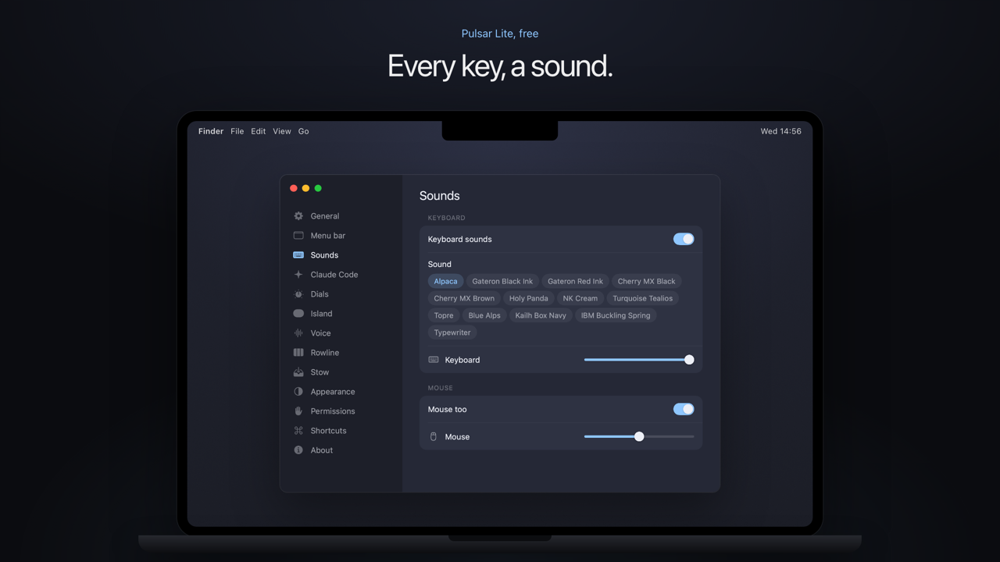

# Pulsar Lite

Pulsar Lite is the free part of Pulsar: a clean menu bar, your desktop in a menu, a sound for every key, the small system switches in one place, and a stash of your favourite sites next to the Dock.

The same prompt also lives in its own repo, [pulsar-lite](https://github.com/juliendesigncraft/pulsar-lite).

## How to use it

1. Download the image in [`images/`](images): the settings window, for the look.
2. Copy the prompt below and paste it into Claude Code, on a Mac, in an empty folder, with the image attached.
3. Build it step by step: Claude shows you a plan first and waits for your OK.



**Prompt, for Claude Code**

````text
Build me a native macOS app (Swift + AppKit, macOS 14 or later) called Pulsar Lite. It lives in the menu bar, has no Dock icon, and starts at login only if I turn it on. No Xcode project: one build.sh that compiles with swiftc and makes the .app.

Work in small steps. Before writing code, show me a short plan and wait for my OK. After every step, build it and tell me how to try it.

1. A clean menu bar
- Pulsar is a small capsule in the menu bar. Left click opens the menu. Right click (or Option click) shows or hides all the hidden icons at once.
- "Clean menu bar" hides every icon to the left of the capsule. I choose what to hide by Command-dragging icons to the left of it. Remember the state between launches.
- "Background apps (n)": every app that lives only in the menu bar (no Dock icon), with its real icon and name, even when there is no room for its icon. Click one to bring it forward. Leave out Apple's own apps.

2. My desktop in a menu
- "Desktop (n)": the folders and files on my Desktop as menu items with their real Finder icons, so colored folders stay recognizable. Folders first, then files, alphabetical.
- Show 5 at the first level and put the rest in "More n...", a submenu that holds all of them, not only the extra ones. Let me choose 4, 5, 6 or 8.
- Nothing is ever moved or changed: it's a list of shortcuts that reads ~/Desktop.

3. A sound for every key
- A sound on every key press and click, in every app.
- Sound packs: a few mechanical keyboards, each with its own space, return and delete, plus the key release. And a typewriter, with a bell on the 62nd key of the line, like reaching the margin.
- The mouse clicks too, with its own sound.
- Two volume sliders, Keyboard and Mouse. When I release a slider, play one key at the new volume.
- Find sound packs under an open license (MIT or CC0) and keep a SOUNDS.md with where each one comes from and its license. Never use sounds from a paid app.

4. The small switches
- Toggles: Dark Mode, Hide desktop icons, Show hidden files, Keep awake, Mute, Stage Manager, Do Not Disturb.
- Actions: Screen saver, Lock screen, Empty Trash (it asks first).

5. Launchers
- A small stash at the bottom left that comes out together with the Dock: my favourite sites in folders (Play, Learn, Tools), round icons, one click opens the site in the browser.
- A settings page to add a site (name and link; without a name take the site, without https:// add it, no duplicates in the same folder), move it, reorder by dragging, make and remove folders. Start with three example folders of free public sites.
- The icons follow System Settings, Appearance, Icons: Regular, Clear or Tinted.

Style
- Dark always, menus and windows, whatever the system theme. Dark #1D1F29, cards #252836, one accent blue #8FC7FF. No borders, no outlines. One typeface only, SF.

Things that will trip you up
- Clean menu bar is the Hidden Bar trick: an invisible status item to the left of the capsule grows to 10,000 pt, and macOS hides whatever doesn't fit.
- On first launch macOS puts a new status item to the left of all the others, so nothing would be hidden. Set a starting position next to the system icons with the "NSStatusItem Preferred Position" defaults key for your items.
- On macOS 26 the status items are hosted by Control Center. If the capsule doesn't show up after a restart, killall ControlCenter and open the app again. Write that in the README.
- Key sounds in other apps need the Accessibility permission. Clicks work without it.
- Sign every build with the same local code signing certificate, not ad hoc. With ad hoc signing macOS ties the permission to the file's fingerprint and every rebuild loses Accessibility.
- Never call AVAudioPlayerNode.play() on the main thread: with a stuck CoreAudio it can wait forever and freeze the whole app. Play sounds on their own queue, keep the voices running, let a new hit interrupt the old one, and drop new hits when more than 4 are waiting.
- When the audio output changes (AirPods, headphones) macOS stops the audio engine. Listen for AVAudioEngineConfigurationChange, reconnect and restart.
- Short clicks sound quiet under music. Give each sound a soft saturation when it loads (tanh, drive 2, peak 0.9) instead of raising the peak.
- Vary the volume of each hit a little, and let up to 12 sounds overlap, so fast typing doesn't cut the tails.
- Dark Mode: AppleScript to System Events (macOS asks for Automation the first time). Hide desktop icons and Show hidden files: defaults write com.apple.finder (CreateDesktop, AppleShowAllFiles), then restart Finder. Keep awake: start and stop caffeinate -di. Stage Manager: defaults com.apple.WindowManager GloballyEnabled.
- Apple has no public API for Focus. Do Not Disturb runs a shortcut I create once in the Shortcuts app, called "Pulsar DND", with the "Set Focus" action.

- Launcher icons: ask only the site itself (apple-touch-icon, then <link rel=icon>, then /favicon.ico), never an outside favicon service. Cache them; a site without an icon shows its initial and is asked again after 7 days.
- The stash copies the Dock: it comes out 0.33 s after the mouse touches the bottom edge and slides up in 0.15 s, fast then braking; it goes back in 0.15 s as soon as the mouse leaves. If the user set autohide-delay or autohide-time-modifier for the Dock, follow those. With magnification on, the icon under the mouse grows to the Dock's largesize and its neighbours shrink in a cosine wave.
- Read global settings like AppleIconAppearanceTheme from UserDefaults.standard: UserDefaults(suiteName: globalDomain) is not allowed and returns nothing.
- The app has no Edit menu, so Command-V never reaches text fields. Forward Command-V, C, X, A and Z to the active field yourself.
- Keep the launchers in a JSON file in Application Support. If it can't be read, set it aside as a .broken copy and start fresh, never overwrite it.

Rules
- Nothing leaves the Mac. No accounts, no analytics, no network.
- A README that says how to build, run and remove the app.
````

It won't come out identical to mine on the first try. You'll get a working first version in a session or two: then use it every day and ask Claude for one detail at a time. When it works, add the other parts of Pulsar to the same app, one folder at a time.

## Credits

Keyboard sounds in my Pulsar: ClickClack by César Ferreira and contributors (MIT). Typewriter: Hermes Precisa 305 recordings by Joseph Sardin, BigSoundBank (CC0). Find your own packs with an open license.
