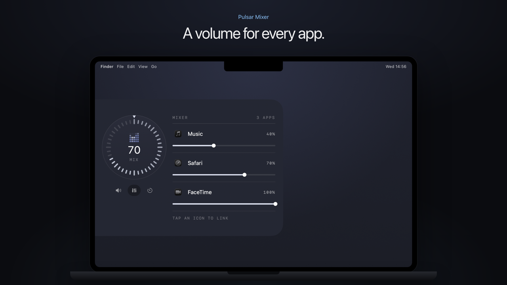

# Pulsar Mixer

Two dials that hide on the left edge of the screen. The top one is the volume: the whole Mac, or a slider for every app that is playing, and a timer. The bottom one is the light: screen and keyboard. Touch the edge and they come out, like the Dock.

## How to use it

1. Download the image in [`images/`](images): the dial with the mixer. You'll attach it as a reference.
2. Copy the prompt below and paste it into Claude Code, on a Mac, with the image attached. Start in an empty folder, or in your Pulsar Lite folder if you built that first.
3. Build it step by step: Claude shows you a plan first and waits for your OK.



**Prompt, for Claude Code**

````text
Build me a native macOS app (Swift + AppKit/SwiftUI, macOS 14.4 or later, Apple Silicon) with two dials that live on the left edge of the screen: one for the volume, with a mixer for each app and a timer, one for the screen and keyboard light. It lives in the menu bar, with no Dock icon. If there is already a Pulsar Lite app in this folder, add this as a new part of it instead of a new app. No Xcode project: one build.sh that compiles with swiftc and makes the .app.

I attached a screenshot of the volume dial in Mix mode: match its layout, spacing, rounded corners and colors as closely as you can.

Work in small steps. Before writing code, show me a short plan and the list of permissions the app will ask for, and wait for my OK. After every step, build it and tell me how to try it.

1. A dial on the edge
- A panel attached to the left edge, top, just under the menu bar. Its corners on the edge side curve outwards into the edge (concave), like a tab growing out of the screen.
- It stays off screen. When the mouse touches the left edge at its height it slides in; half a second after the mouse leaves it goes away.
- The dial: 40 ticks in a ring that light up with the value, a small triangle on top, the number and the mode in the middle.
- Turn it with the scroll wheel or two fingers on the trackpad over the dial, or by dragging on the ring (the angle from the top is the value). A click in the centre does the mode's action.

2. Volume, three modes (three round buttons under the dial)
- Volume: the Mac's output. Click in the centre: mute on and off.
- Mix: next to the dial, the list of apps that are playing sound right now, each with its icon, name, percentage and a slider. Click an app's icon to link it (a ring around it): the dial moves all linked apps together, or all of them if none is linked. Group helpers under their app (Chrome Helper under Chrome, WebKit under Safari). Remember each app's volume: if Spotify was at 60%, it starts again at 60% the next time it plays.
- Timer: 1 to 60 minutes. Click in the centre to start and stop. At the end, two soft chimes and the dial comes out by itself for a few seconds.

3. Light
- A second dial with the same shape, bottom left (above the Dock if the Dock is at the bottom). It comes out when the mouse touches the left edge down there.
- Two modes, Screen and Keyboard. Click in the centre: on the screen it switches to the keyboard; on the keyboard it turns the light off and back on at the level it had.
- Reread the values every second, so the dial follows the F1, F2, F5, F6 keys and the light sensor.

4. Inside the dial, a small 5x5 dot animation that shows the mode and never stops moving: columns that rise to the level and breathe for the volume, an X for mute, a ring that empties for the timer, a sun that grows with the level for the screen, rows lit from the bottom for the keyboard. The amount of grid that is lit is always the level.

5. Settings
- In the menu: dial on the left edge on or off, light on or off, "Show dial" to bring it out for a few seconds.

Style
- Apple style, Dark and White Matte following the system. Dark Matte: panel #16181F, cards #21242D, text #E3E7EF, secondary text #A4ABBA, accent #8FC7FF. White Matte: panel #F7F8FA, cards #FBFBFC, text #1E2129, secondary text #545A69, accent #3B82D0.
- Lit ticks and the triangle in a light grey-white on dark, graphite on light. Amber only for warnings, slightly muted. No borders, no outlines. SF for text, a small monospace only for the labels in capitals (MIXER, 3 APPS, MIX).

Things that will trip you up
- The volume of each app uses Core Audio process taps (macOS 14.4+, AudioHardwareCreateProcessTap), no driver. Capture the app's sound, mute it at the source, and play it back to the output multiplied by the chosen volume. At 100% close the tap and let the app play by itself again.
- When the output changes (headphones, AirPods), the taps are tied to the old device: rebuild them on the new one.
- The first time you lower an app macOS asks for "System Audio Recording" (Privacy and Security, Screen and System Audio Recording). If it is missing, say it in the mixer in one amber line instead of failing silently.
- Apple has no public API for screen and keyboard brightness. Screen: DisplayServices. Keyboard: KeyboardBrightnessClient from CoreBrightness, with setBrightness:fadeSpeed:commit:. Load them at runtime with dlopen and check every symbol: if a macOS version removes them, the dial says NOT AVAILABLE instead of crashing.
- When the room is bright enough, macOS turns the keyboard light off by itself and ignores every command, even F5 and F6. Detect it and show SUSPENDED instead of the mode.
- Mouse at the edge: use a global mouse-moved monitor, but look at the position only when it touches an edge or a dial is out, and use no timer when everything is still. The panels must never steal focus (non-activating).
- The dials sit at the edge of the screen: compute the concave corners in one shape and reuse it for both dials, mirrored for the other edge if you let them move later.
- Fix the window sizes (sizingOptions = []), or SwiftUI resizes the panel when the list of apps changes and it slides off the edge.
- macOS's own window shadow adds a thin dark line you can't control. If you want a soft shadow without a border, put a twin child window behind each panel that draws only the shadow of its shape.

Rules
- Nothing leaves the Mac. The mixer changes volumes and records nothing. No accounts, no analytics.
- Ask for System Audio Recording only the first time I lower an app, with one line that says why.
- A README that says how to build, run and remove the app.
````

It won't come out identical to mine on the first try. You'll get a working first version in an afternoon: then play music in two apps, compare it with the image and ask Claude for one detail at a time.
