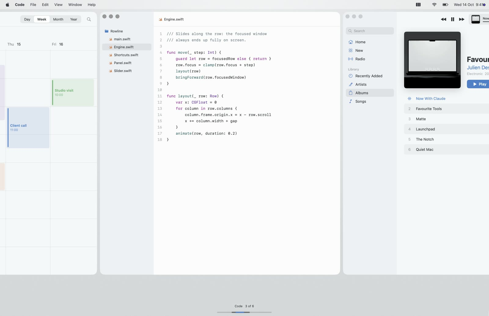
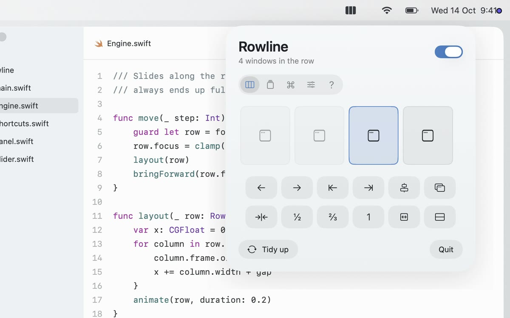

# Rowline

My window manager: every window side by side in one row that scrolls, instead of a pile. A thin slider at the bottom shows where you are. Workspaces, shortcuts, three-finger swipes.

Prefer the code? The full source of the version in my reel is on GitHub: [juliendesigncraft/rowline](https://github.com/juliendesigncraft/rowline).

## How to use it

1. Download the two images in [`images/`](images): the row with the slider and the menu bar panel. You'll attach them as references.
2. Copy the prompt below and paste it into Claude Code, on a Mac, with the two images attached. Start in an empty folder, or in your Pulsar folder if you built another part first.
3. Build it step by step: Claude shows you a plan first and waits for your OK.

| The row | The panel |
|---|---|
|  |  |

**Prompt, for Claude Code**

````text
Build me a native macOS app (Swift + AppKit/SwiftUI, macOS 14 or later) called Rowline: a scrolling window manager that keeps every window side by side in one horizontal row, instead of letting windows pile up. It lives in the menu bar, with no Dock icon. If there is already a Pulsar app in this folder, add this as a new part of it instead of a new app.

I attached two screenshots (the row with the slider at the bottom, and the menu bar panel): match their look, spacing, rounded corners and colors as closely as you can.

Work in small steps. Before writing code, show me a short plan and wait for my OK. After every step, build it and tell me how to try it.

1. The row
- Every screen has its own row. Each spot in the row is a column: half, two thirds or full screen wide, with a small gap between columns.
- A new window lands right after the one I'm using. Closed, minimized or hidden windows leave the row.
- The row scrolls: the focused window is always fully on screen. Windows outside the view are parked in the bottom right corner (1 px visible) and come back when I click them, use Cmd-Tab or the Dock.
- Windows slide into place with a short animation (about 0.2 s, ease out).
- Leave free: dialogs, sheets, minimized, full screen and fixed size windows, and apps I put on an "always free" list.
- When the app quits or is turned off, every parked window comes back on screen.

2. Shortcuts (global, all changeable in the panel, default Control + Option + Command)
- Left / right: focus the window on the left or right. Shift adds: move the window left or right in the row.
- 1, 2, 3: half, two thirds, full width. R: cycle widths. = and -: wider or narrower in small steps.
- C: centre the focused window. [ and ]: stack it into the column on the left or right. Shift + [ ]: pop it out of the stack.
- T: float the window above the row, or put it back. N: send it to the other display.
- Hold the three modifier keys for a second: a sheet with every shortcut appears; let go and it disappears.

3. The slider
- At the bottom centre of each screen, above the Dock: one single thin line, as long as the whole row. Light along the whole row, brighter where the screen is, accent blue on the focused window. No container, no border.
- Hover makes the line thicker. Click a point on it to focus the window under it. Drag to slide the row.
- When the focus changes, show the app name and its position ("Notes 3 of 6") above the lines for a moment.
- Reserve its space so windows never cover it.

4. The menu bar panel
- Tabs: the row (a small map of the windows, click to focus, buttons for every command), workspaces (save the current row with a name and restore it with one click, opening apps that are closed), shortcuts (click a row, press new keys), settings, how it works.
- Settings: trackpad swipe (three or four fingers, or Option + two fingers), animations, slider always / when it changes / never, gap between windows, how much neighbours peek in, width rules per app, apps that stay free.
- Right click on the menu bar icon: a normal menu with open, turn off, tidy up, quit.

Style
- Apple style, Dark and White Matte following the system. Dark: panels #2B2E3C to #22252F, white text, accent #8FC7FF. Light: panels #F6F7F9 to #EEF0F3, text #1E2028, accent #3B82D0. No borders, no outlines. One typeface only, SF.

Things that will trip you up
- Use the Accessibility API to move windows (AXPosition, AXSize). Set the size, then the position, then the size again, or the screen edge clamps it.
- Get window ids with _AXUIElementGetWindow, and only adopt windows that are on the current desktop.
- Carbon RegisterEventHotKey for shortcuts (no extra permission). The three-finger swipe needs reading the trackpad; if the system already uses that gesture, say so in the settings.
- Measure SwiftUI content before sizing a borderless panel, or it opens 0 x 0.
- Sign the app with a fixed certificate and keep the same bundle id between builds, or macOS asks for Accessibility again after every build.

- Parking: windows out of view go to the bottom right corner with 1 px still on screen. A window moved fully off screen gets pulled back by macOS.
- If the app quits, is killed or is turned off, bring every parked window back on screen, in a cascade. If it crashes, the next launch must do it first.
- Work only on the current desktop (Space): when I switch desktop, rebuild the row with that desktop's windows. Switching desktops 1 to 9 yourself is not possible without private APIs or simulated keys: leave it out.
- The swipe reads the trackpad from MultitouchSupport, a private framework: load it at runtime and turn the gesture off if it is missing.
- Use Control + Option + Command as the default modifiers: Control + Option alone collides with too many apps and with dictation tools.
- A grid (Control-Option-Command-G): a small grid with the screen's proportions, 6 x 4 by default; drag over the cells and the focused window floats out of the row into that area, with the same gaps. Arrows move, Shift and arrows resize, Return places, Esc closes.

Rules
- One permission only: Accessibility, asked the first time with one line that says why.
- Nothing leaves the Mac. No accounts, no analytics.
- A README that says how to build, run and remove the app.
````

It won't come out identical on the first try. You'll get a working first version in an hour or two: then compare it with the images and ask Claude for the details, one at a time.
