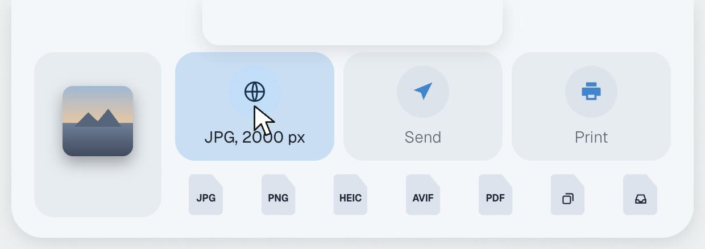
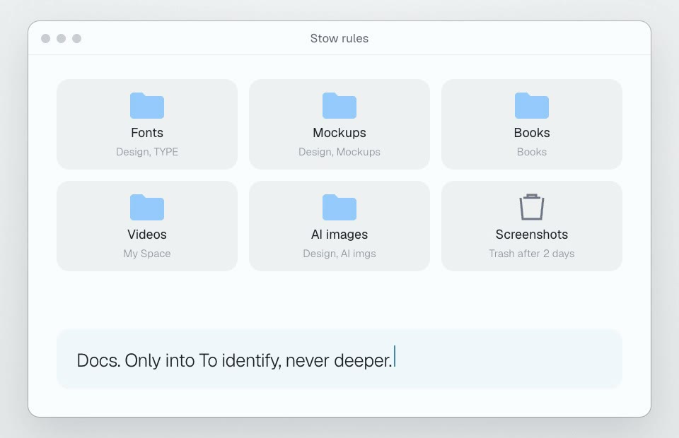

# Stow

Drop a file on the notch and it changes form: for the web, to send, to print, or any format you pick. And when your Desktop and Downloads fill up, Stow puts things away with your own rules, tells you where, and lets you undo it.

## How to use it

1. Download the two images in [`images/`](images): the panel under the notch and the rules window. You'll attach them as references.
2. Copy the prompt below and paste it into Claude Code, on a Mac, with the two images attached. Start in an empty folder, or in your Pulsar folder if you built another part first.
3. Build it step by step: Claude shows you a plan first and waits for your OK.

| Drop on the notch | Your rules |
|---|---|
|  |  |

**Prompt, for Claude Code**

````text
Build me a native macOS app (Swift + AppKit/SwiftUI, macOS 14 or later) called Stow. Two jobs: convert files I drop on the notch, and keep my Desktop and Downloads tidy with my own rules. It lives in the menu bar, with no Dock icon. If there is already a Pulsar app in this folder, add this as a new part of it instead of a new app.

I attached two screenshots (the panel that opens under the notch, and the rules window): match their look, spacing, rounded corners and colors as closely as you can.

Work in small steps. Before writing code, show me a short plan and wait for my OK. After every step, build it and tell me how to try it.

1. Drop on the notch
- When I start dragging a file anywhere and bring it near the notch, a panel opens under the notch (attached to it, never covering the menu bar).
- On the left, a real Quick Look preview of the file in my hand (a small stack with a number if there are more).
- Three big tiles say what the file is for: Web, Send, Print. Each picks format and size for me: Web = JPEG, longest side 2000 px, light enough for a website; Send = JPEG, 2048 px, lighter still; Print = PDF. Video: Web = MP4 1080p, Send = MP4 720p. Hide a tile when it makes no sense (you don't print an audio file).
- Below, every output format as a small document icon with the letters on it (JPG, PNG, HEIC, AVIF, PDF...), and "Merge into one PDF" when I drop two or more images.
- The tile under the mouse lights up and gives a small bounce, and only then shows the details ("JPG, 2000 px"). One word per tile otherwise.
- Drop: the new file is created next to the original. Never overwrite: if the name exists, add " 2", like the Finder. The original is never touched.

2. Put things away
- Watch the top level of Desktop and Downloads (each can be turned off). A file that has stayed still for 2 minutes (1, 2 or 5, my choice) goes to the folder of the first rule that matches.
- A rule = file extensions and/or words in the name, and a destination folder (or the Trash, with its own wait: screenshots after 2 days).
- Never touch folders, aliases, apps, hidden files, downloads in progress (.crdownload, .part, .download) or files that are still growing.
- Only files that arrive after I turn it on; a button does the old ones once.
- Converted files can follow the same rules.
- Personal documents (PDF, Word, invoices) only ever go to one inbox folder I choose, never deeper: I sort those myself.

3. Tell me where
- After every batch the closed notch widens for a few seconds: a folder icon that bounces, "4 tidied", and two small icon buttons, Undo and Show in Finder. The details ("3 in Design, 1 in Books") appear on hover.
- Undo puts every file back where it was (or brings it back from the Trash).
- Keep a plain text log of every move.

4. Settings (a small window from the menu bar)
- The rules as a grid of folders, each with a symbol for its kind of file; click one to pick another folder.
- Icon toggles for Desktop, Downloads and "converted files follow the rules", and the wait in minutes.

Style
- Apple style, Dark and White Matte following the system: dark #1D1F29 panels with #252836 cards, light #F4F6F9 with #E8ECF2 cards, one accent blue (#8FC7FF dark, #3B82D0 light). No borders, no outlines. One typeface only, SF.

Things that will trip you up
- While I drag a file from the Finder, macOS doesn't send mouse events to your app. Put an invisible panel (alpha 0.004, not 0) over the notch that registers for dragged file URLs; when a drag enters, grow it to cover the whole drop panel and read the drop there. Read the files in hand with NSPasteboard(name: .drag).
- The tile under the mouse: compute it from the mouse position with the same numbers the view uses for its layout, in one pure function you can test.
- ImageIO reads WebP but cannot write it: add libwebp (BSD license, static library). Everything else is built in: ImageIO (JPEG, PNG, HEIC, AVIF, TIFF, GIF), AVFoundation (MP4, MOV, M4A, WAV, AIFF, FLAC), PDFKit (merge, split, compress with the "Reduce File Size" Quartz filter), textutil (DOCX, RTF, TXT, HTML). MP3, WebM and MKV are not: leave them out and say so.
- DOCX to PDF: NSPrintOperation that saves to a file gives real A4 pages; run it on the main thread.
- For "arrived after I turned it on" use the date added to the folder, not the modification date (downloads keep the server's date).
- Moving a file to the Trash with FileManager.trashItem gives you its new location: keep it, it's how Undo works.
- On a Mac without a notch, draw a fake one at the top centre so the drop target still exists.

- Two or more files of different kinds: show only the purposes that exist for all of them, and let each file take its own recipe. No single format tile in that case.
- One file that fails never stops the batch. At the end the notch says "9 done, 1 failed", and the reason appears on hover.
- Files that live only in iCloud: move them inside iCloud, never download them to move them.
- Keep the user's own folders in the settings file, never in the code.

Rules
- Nothing leaves the Mac. No accounts, no analytics.
- Write tests for the pure parts: rule matching, file names that never overwrite, the tile under the mouse, the undo plan.
- A README that says how to build, run and remove the app.
````

It won't come out identical on the first try. You'll get a working first version in a couple of hours: then compare it with the images and ask Claude for the details, one at a time. Write your own folder rules, that's the part that makes it yours.

## Credits

WebP in my Stow: libwebp by Google (BSD license).
