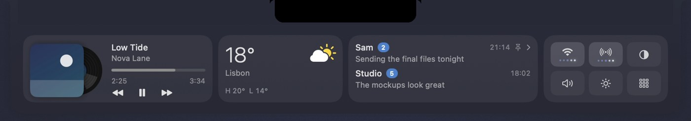
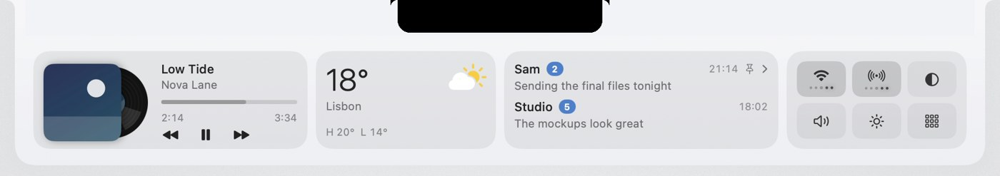

# Pulsar Themes: Dark Matte and White Matte

Two flat, matte themes and one switch. Pick White Matte and the whole screen follows: every part of Pulsar, macOS light or dark, the wallpaper, the icons of your Desktop folders, and any app of yours that listens.

## How to use it

1. Download the two images in [`images/`](images): the same island in Dark Matte and White Matte. You'll attach them as references for the colors.
2. Copy the prompt below and paste it into Claude Code, on a Mac, with the images attached. This one works best inside a Pulsar you already built (Lite or any other part), but it also works on its own.
3. Build it step by step: Claude shows you a plan first and waits for your OK.

| Dark Matte | White Matte |
|---|---|
|  |  |

**Prompt, for Claude Code**

````text
Add two themes, Dark Matte and White Matte, to the macOS app in this folder (Swift + AppKit/SwiftUI). If there is no app here yet, build a small menu bar app (no Dock icon) that only does this. No Xcode project: one build.sh that compiles with swiftc and makes the .app.

I attached two screenshots of the same panel in Dark Matte and White Matte: use them to check the colors and the shadows.

Work in small steps. Before writing code, show me a short plan, which files you will touch and the permissions the app will ask for, and wait for my OK. After every step, build it and tell me how to try it.

1. One source for the theme
- One Theme type that holds the whole palette and is written in one place. Every window and view reads from it, and changes at once when I switch, without a restart.
- Dark Matte: background #16181F, cards #21242D, text #E3E7EF, secondary text #A4ABBA, accent #8FC7FF.
- White Matte: background #F7F8FA, cards #FBFBFC, text #1E2129, secondary text #545A69, accent #3B82D0.
- Flat and matte: no glass, no gradients, no borders, no outlines. The accent for every "active" or "new" state, never green. Amber and red only for warnings, slightly muted.
- Anything that continues the real notch stays black in both themes.

2. One switch
- In the menu: THEME, Dark Matte or White Matte, with a tick on the active one. Control-Option-L goes from one to the other.

3. The whole screen follows
- macOS appearance: light for White Matte, dark for Dark Matte.
- The wallpaper: two images I choose once in the settings, one per theme.
- The icons of my Desktop folders: a dark and a light set of folder icons, applied to the folders I list in the settings. Generate the two sets with a small script: same shapes and symbols, the light set recolored, with the flap fading from light to grey like a real shadow.
- Other apps: write the choice to a small theme.json in Application Support ({"theme": "dark-matte" or "white-matte", "light": true or false, "when": seconds}) and post a distributed notification with the theme name, so my other apps can follow.

4. One shadow for everything
- The same small shadow under every panel, decided in one place. Dark Matte: black at 9%, radius 8, 1.5 pt down. White Matte: #8A93A6 at 6.5%, radius 11, 1.5 pt down.

Things that will trip you up
- macOS appearance: AppleScript to System Events ("tell appearance preferences to set dark mode to true"). The first time macOS asks for Automation. Try the command first and show a warning only if macOS really refuses it: a preventive check with AEDeterminePermissionToAutomateTarget can say no even when the switch is on.
- The tick for dark mode must read the system theme (AppleInterfaceStyle), not your app's own appearance, which you may have forced.
- Folder icons: NSWorkspace.setIcon fails silently off the main thread. Apply them on the main thread, or some folders keep the old color.
- The wallpaper: NSWorkspace.setDesktopImageURL for every screen. Dynamic "aerial" wallpapers are not images you can read or replace the same way: say so.
- macOS's own window shadow adds a thin dark line around borderless windows and you can't tune it. For a soft shadow with no border, turn it off and put a twin child window behind each panel that draws only the shadow of its shape and moves with it.
- The mouse pointer color (Accessibility, Display, Pointer) has no public command to refresh it at once: if you change it, it may only update at the next login. Say so instead of faking it.
- Chrome and other browsers can't be themed from outside: if I want them to match, make two small theme extensions I load by hand from chrome://extensions.

Rules
- Nothing leaves the Mac. No accounts, no analytics.
- Never touch files inside my folders: only their icons.
- A README that says how to build, run and remove the app, and how my other apps can read theme.json and listen for the notification.
````

It won't come out identical to mine on the first try. Switch back and forth a few times, find the window that didn't follow, and ask Claude to fix that one.
